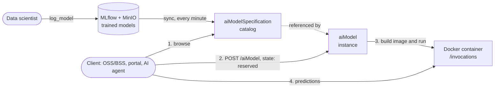

# TMF 915 AI Management API

A Spring Boot implementation of the [TM Forum TMF915 AI Management API](https://www.tmforum.org/) (v4) for [OpenSlice](https://osl.etsi.org/). It turns models tracked in **MLflow** into a TMF catalog of AI model specifications and deploys them on demand as **Docker** inference endpoints.



## What it does

- **Catalog:** discovers models in MLflow every minute and publishes each one as an `aiModelSpecification`.
- **Deploy:** creating an `aiModel` in state `reserved` builds a serving image and starts a container; the model becomes `active` with an `endpoint` and an example request body.
- **Lifecycle:** scheduled start and end dates, undeploy (`inactive`), delete, and recovery after a restart.
- **Access:** REST API secured with Keycloak (OAuth 2.0), optional TMF Hub webhooks, and a read-only MCP server for AI agents. The MCP server has no authentication; keep it on a trusted network ([details](docs/INTEGRATION_GUIDE.md#6-mcp-server-for-ai-agents)).

Implemented TMF915 resources: `aiModel`, `aiModelSpecification` and the event subscription `hub`. The other resources in the specification (alarm, rule, monitor, topic, aiContract, …) return `501 Not Implemented`.

## Quick start

Requires Docker with Compose v2. The image builds the application itself.

```bash
# Everything local: MySQL, Keycloak, MinIO, MLflow and the API
export MLFLOW_TRACKING_URI=http://mlflow:5000 MLFLOW_S3_ENDPOINT_URL=http://minio:9000
docker compose --profile full up -d --build
```

On a new machine, first follow [Run the platform](docs/USER_GUIDE.md#1-run-the-platform): `docker-compose.yml` sets the token issuer to a lab address, and the API rejects every token until it matches yours.

| | URL |
|---|---|
| Swagger UI | http://localhost:13082/tmf-api/swagger-ui.html |
| Health | http://localhost:13082/tmf-api/health |
| API base | http://localhost:13082/tmf-api/AiM/v4 |
| Keycloak | http://localhost:8080/auth (realm `openslice`, user `admin` / `openslice`) |
| MLflow / MinIO console | http://localhost:5000 / http://localhost:9011 |

## Documentation

| Guide | For |
|---|---|
| [User guide](docs/USER_GUIDE.md) | Running the platform and using the API day to day: tokens, catalog, deploy, inference, configuration, troubleshooting |
| [Model publishing guide](docs/MODEL_PUBLISHING_GUIDE.md) | Data scientists who want their model in the catalog and served through the API |
| [Integration guide](docs/INTEGRATION_GUIDE.md) | Developers connecting another system (OSS/BSS, orchestrator, AI agent) to the API, or adding a new serving platform |
| [Deployment flow](docs/AI_MODEL_DEPLOYMENT_FLOW.md), [database schema](docs/DATABASE_SCHEMA.md) | Internals |

A Postman collection covering the full flow is in [`postman/`](postman/).

## Development

```bash
mvn test        # unit and HTTP-level tests; uses H2, no external services needed
```

Tests run with `src/main/resources/application.yml` plus the overrides in `src/test/resources/application.properties`. Integration tests (`*IntegrationTest`, profile `integration`) need a real MLflow server, MinIO and a Docker daemon, and are excluded from `mvn test`.

The API interfaces and models in `api/` and `model/` were generated from `.openapi-generator/TMF915_AI_Management_API_v4.0.0.oas.yaml` with OpenAPI Generator (`spring`, delegate pattern) and then edited by hand (JPA mappings, serialization). Do not regenerate over them.

## Acknowledgement

<p>
  <a href="https://www.6g-xcel.eu/"></a>
  &nbsp;&nbsp;&nbsp;
  <a href="https://smart-networks.europa.eu/">
    <picture>
      <source media="(prefers-color-scheme: dark)" srcset="docs/images/sns-logo-dark-mode.png">
      
    </picture>
  </a>
</p>

This work was developed for the [6G-XCEL](https://www.6g-xcel.eu/) project.

Co-Funded by the European Union. Views and opinions expressed are however those of the author(s) only and do not necessarily reflect those of the European Union.

6G-XCEL project has received funding from the [Smart Networks and Services Joint Undertaking (SNS JU)](https://smart-networks.europa.eu/) under the European Union's Horizon Europe research and innovation program under Grant Agreement No 101139194.

## License

GPL-3.0. See [LICENSE](LICENSE).
