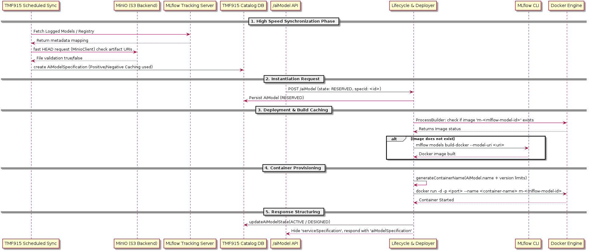

# AI Model Deployment Workflow & Developer Guide

This document describes the end-to-end lifecycle of an AI model deployment in the TMF915 implementation. It provides structural visibility into the optimization logic, mapping behaviors, and container orchestration flows between the Spring Boot application and the MLflow Tracking Server.

## Architecture & Communication Flow

## Internal Domain Mechanics

### 1. High-Performance Synchronization

The generic `CatalogSyncService` runs every platform's `CatalogSource` (MLflow: `MlflowCatalogSource`) once a minute and checks storage directly from Java (MinIO client), without Python.

* **Dual Compatibility:** The MLflow source searches the **Logged Models API** (MLflow 3) and falls back to the **Classic Model Registry API** when a full search finds no logged models.
* **Incremental searches:** Between full searches (every 10 minutes), only models created since the newest one seen are fetched, with a 5-minute overlap.
* **Positive Cache (Passive):** Once a model is catalogued, its key (MLflow: `{experimentName}:{modelId}`) is remembered per source. Later sync cycles skip the database lookup entirely.
* **Negative Cache (Active Backoff):** Models that are logged but whose files are not in MinIO yet are skipped for 10 minutes. The check lists at most one object under the artifact URI.
* **Platform-neutral fields:** every synced specification gets `platform`, `artifactFormat` and, if the model can be downloaded, the download `attachment`.

### 2. Model Instantiation API Handling

When a client executes a `POST /aiModel` payload targeting an `AiModelSpecification`:

* The application isolates TMF 638 `Service` inheritance models from TMF 915 models using `@JsonIgnore` specifically over the `serviceSpecification` mapping. This ensures payloads exclusively communicate native `aiModelSpecification` identities without duplicating blocks.
* Setting `"state": "reserved"` automatically assigns the deployment to `DeploymentScheduler.executeDeployment(AiModel)`.

### 3. Build Optimization & Container Naming Maps

To achieve horizontal model scales (spawning identical containers rapidly) without blocking CPU time recompiling identical ML Docker environments:

1. **Docker Image Identity (`imageName`):**
   * Driven exclusively by the MLflow Object Hash, formatted rigidly via `sanitizeImageName(modelId)` keeping its MLflow signature (e.g., `m-846ff5a9b35e...`).
   * TMF915 queries Docker explicitly to see if `m-846ff5a9b35e...` already lives on the host. If true, `mlflow models build-docker` is universally bypassed.
2. **Docker Container Identity (`containerName`):**
   * One container per `AiModel`. `MlflowModelService.generateContainerName()` returns `<AiModel name>-<first 8 characters of the AiModel id>`, for example `my-ai-model-name-3f2c9a1b`, next to the image `m-846ff…`. AiModel names are not unique; the id part keeps container names unique.
   * Every container carries two labels:
     * `tmf915.aiModelId=<id>`: undeploy stops a container only when this label matches the model. Containers started before labels existed (named `<name>-v<version>`) are recognised by that old name.
     * `tmf915.deployAttempt=<uuid>`: one value per `docker run`. A failed attempt removes only the container it created, never a container found by name.
   * Host ports are scanned from `host-port-start` to `host-port-end`, but only a port conflict moves on to the next port. Any other `docker run` error fails the deployment at once.
3. **Image removal:** undeploy removes the image only when no other `active` model uses it and no `reserved` model of the same MLflow model is waiting for it, and never with `-f`.

### 4. Lifecycle Finalization & Reversion Strategy

Depending heavily on network stability and the Docker Daemon socket capabilities (`tcp://host:2375` or `/var/run/docker.sock`), failures do occur.

`DeploymentScheduler.executeDeployment` works in three steps, so that a build lasting minutes never holds a database connection:

1. **Read** the model in a short read-only transaction.
2. **Deploy**, outside any transaction. `MlflowDeployer.deploy` builds the image (if needed), starts the container, and returns the characteristics to record: `endpoint`, `containerId`, `hostPort`, `imageName`, `dockerHost`, `deployedAt`, `inferencePayloadExample`.
3. **Record** the outcome in a short transaction (`AiModelRepositoryService.updateIfInState`), only if the model is still `RESERVED`:
   * **ACTIVE:** the characteristics replace any with the same name, and the state becomes `ACTIVE`.
   * **DESIGNED:** on failure, the state becomes `DESIGNED` and a note gets a short reason and a reference id. The full exception is in the server log under that reference.
   * **Stopped or deleted meanwhile:** nothing is recorded; the container just started is undeployed instead.

After each recorded change, an `AiModelStateChangeEvent` is published (webhooks, if enabled). Teardown at `endDate` (`executeUndeploy`) follows the same pattern and records `TERMINATED`.
